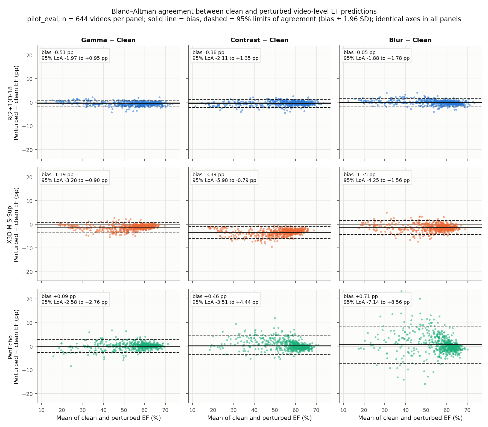
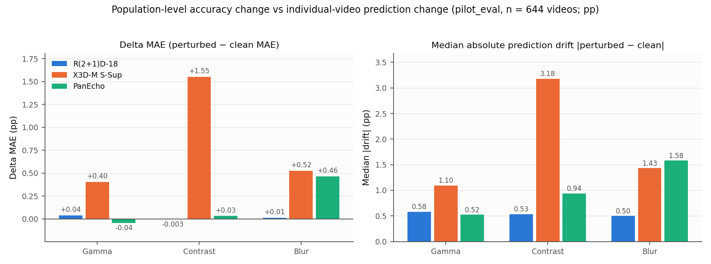

# EchoNet-Dynamic Phase 2 — Accuracy vs. Prediction Stability Pilot

**A New Research Question.** Can a model have similar average EF accuracy before and after an input change while individual video predictions still move substantially?

**Setup in one line.** We evaluated three frozen EF prediction systems, namely R(2+1)D-18 (Phase 0), X3D-M S-Sup (Phase 1, seed 1001), and PanEcho v1.0 × four input conditions (clean, gamma, contrast, blur)
× the fixed 644-video Phase 1 `pilot_eval` subset (official VAL videos). 
 
**Short answer.** Yes, in this pilot.

- In five of the nine model–perturbation pairs, MAE barely changes: |Delta MAE| < 0.05 pp. This cut-off is a
  descriptive grouping chosen after seeing the results, not a pre-specified decision threshold.
- In those same five pairs, individual predictions still moved:
  - 95th-percentile drift 1.76–4.85 pp;
  - largest single drift 4.03–11.96 pp, depending on the pair.
- Under blur, two systems with similar Delta MAE (+0.52 vs +0.46 pp) have limits of agreement that differ 2.7-fold in width.

---

## Task 1. Concepts

Suppose videos A and B have reference EFs of 50% and 60%. The model predicts 48% and 62% on the original videos, and 46% and 60% after blur.

| Concept | Definition | Example |
|---|---|---|
| Accuracy vs. stability | **Accuracy** measures closeness to the reference EF. **Stability** measures how little a prediction changes for the same video. | For B, the prediction moves from 62% to 60%. It becomes more accurate while drifting by 2 pp. |
| Paired evaluation | Compare the same frames from the same video before and after a change, using the same method to combine clip predictions. | X3D-M averages predictions from the same four 16-frame clips before and after blur. |
| Mean absolute error (MAE) | The average absolute difference between predicted and reference EF. | On the original videos, A and B are each off by 2 pp, so MAE is 2 pp. |
| Delta MAE (ΔMAE) | MAE after the change minus MAE before the change. | After blur, A’s error rises to 4 pp and B’s falls to 0 pp. Their average is still 2 pp, so ΔMAE is 0 pp. |
| Absolute prediction difference (drift) | The size of the change in one video’s prediction, regardless of direction. | A moves from 48% to 46%, so its drift is 2 pp. |
| Bland–Altman analysis | Plots the signed change against the mean of each pair of predictions. Bias is the mean change. The 95% limits of agreement are bias ± 1.96 × SD of the changes. | A appears at x = 47%, the mean of 48% and 46%, and y = −2 pp, its downward shift. |
| Correlation vs. agreement | **Correlation** measures whether predictions vary together. **Agreement** measures how closely paired values match. | If 40%, 50%, and 60% become 45%, 55%, and 65%, correlation is 1 even though every prediction rises by 5 pp. |
| Stable but inaccurate model | A model can give the same prediction every time and still be far from the reference EF. | Always predicting 55% gives zero drift but a 25 pp error on a video with reference EF 30%. |
| Synthetic perturbation | A controlled change to image appearance that preserves the reference EF. | Blurring video A softens its edges. Its reference EF stays at 50%. |

---

## Task 2. Controlled paired predictions

### A. Model and Inference Check

| Model | Checkpoint / Source | Frames per Clip | Image Size | Video-Level Aggregation | Frozen? |
|---|---|---:|---:|---|---|
| R(2+1)D-18 | Phase 0 EF regression model, `output/phase0_full/video/best.pt` (epoch 29), SHA-256 `3a646d9e…dbcb` | 32 (sampling period 2, spanning 63 source frames) | 112 × 112 (native) | Mean of **all** clips: one clip starts at every frame 0 … F−63 (videos shorter than 64 frames are zero-padded, as in the echonet code); 2–628 clips per video (median 112), 75,252 clips in total | Yes |
| X3D-M S-Sup | Phase 1 S-Sup seed 1001, `output/phase1/s_sup_seed1001/full_428/epoch_10.pt` (best epoch 10, selection MAE 5.51 pp), SHA-256 `a6661d73…c8a2` | 16 consecutive frames | 224 × 224 (112 → 256 INTER_AREA resize, centre crop) | Mean of 4 clips with evenly spaced starts `linspace(0, F−16, 4)` (Phase 1 protocol) | Yes |
| PanEcho | Public CarDS-Yale PanEcho v1.0 `panecho.pt`, `tasks=["EF"]`, SHA-256 `896a279d…2da35` | 16 consecutive frames | 224 × 224 (same resize/crop) | Mean of the same 4 clips as X3D-M (Phase 1 protocol) | Yes |

- **Frozen.** All three models ran in `eval()` mode with 0 trainable parameters. A parameter digest was taken before and after inference, and the two were identical (`run.json → models_info`).
- **Frame indices.** Each model's indices were generated once (job 541) and saved read-only in `frame_indices/<model>_frame_indices.json.gz`. A hash of the indices actually used was recorded for each condition, and the four hashes are identical within every model.
- **Clean outputs reproduce earlier validated inference on all 644 videos.**
  - R(2+1)D-18 vs Phase 0 evaluation job 410: per-clip difference ≤ 5 × 10⁻⁵ pp. The Phase 0 values were printed
    to 4 decimals, so this is rounding.
  - X3D-M vs Phase 1 job 429: ≤ 8.9 × 10⁻⁶ pp.
  - PanEcho vs Phase 1 job 429: ≤ 7.5 × 10⁻⁶ pp.
  - Source: `runs/*/clean_reproduction.json`.
- **Repeat inference within the run.**
  - Scope: clean condition only, all clips, all three models, on the first 16 `pilot_eval` videos in manifest order.
  - Result: bit-identical outputs (max difference 0.0; `runs/*/repeat_check.csv`).
  - Not repeated: the other 628 videos and the perturbed conditions.
- **Segmentation and beat detection** For R(2+1)D-18, we ran only the Phase 0 EF regression model, as specified.

### B. Perturbation Settings

| Condition | Function / Implementation | Exact Setting |
|---|---|---|
| Clean | None | No perturbation |
| Gamma | `out = 255 · (in/255)^γ` per pixel (`phase2_common.perturb`) | γ = 1.2 (mid-tones slightly darker; 0 and 255 unchanged) |
| Contrast | `out = c · (in − 127.5) + 127.5` per pixel | c = 0.8 around fixed mid-grey 127.5 |
| Gaussian blur | Separable spatial Gaussian, normalized weights, reflect-101 borders, no temporal blur | σ = 0.5 px of the native 112 × 112 frame, kernel 5 × 5 |

### C. Prediction Coverage

| Model | Expected Videos | Clean | Gamma | Contrast | Blur | Missing / Failed |
|---|---:|---:|---:|---:|---:|---|
| R(2+1)D-18 | 644 | 644 | 644 | 644 | 644 | 0 |
| X3D-M S-Sup | 644 | 644 | 644 | 644 | 644 | 0 |
| PanEcho | 644 | 644 | 644 | 644 | 644 | 0 |

All values are finite and video IDs are unique. Reference EF is identical across the three tables, and tables are
merged by `video_id`. 

---

## Task 3. Average accuracy vs. individual prediction stability

### A. Accuracy Results (pp)

| Model | Clean MAE | Gamma MAE | Gamma Delta MAE | Contrast MAE | Contrast Delta MAE | Blur MAE | Blur Delta MAE |
|---|---:|---:|---:|---:|---:|---:|---:|
| R(2+1)D-18 | 4.19 | 4.23 | +0.04 | 4.19 | −0.003 | 4.21 | +0.01 |
| X3D-M S-Sup | 5.92 | 6.32 | +0.40 | 7.47 | +1.55 | 6.44 | +0.52 |
| PanEcho | 5.78 | 5.74 | −0.04 | 5.81 | +0.03 | 6.25 | +0.46 |

**Observations.**

- R(2+1)D-18 has the lowest clean MAE, and its MAE barely changes under any perturbation (|Delta MAE| < 0.05 pp).
- PanEcho's MAE barely changes under gamma and contrast, and rises by 0.46 pp under blur.
- X3D-M S-Sup's MAE rises under all three perturbations. The largest rise is under contrast: +1.55 pp on a clean
  MAE of 5.92 pp, 26.2% relative.
- Under gamma and blur, X3D-M and PanEcho start from similar clean MAE (5.92 vs 5.78 pp).

### B. Prediction Drift (|perturbed − clean|, pp)

| Model | Condition | Mean Absolute Drift | Median [IQR] | 95th Percentile |
|---|---|---:|---|---:|
| R(2+1)D-18 | Gamma | 0.70 | 0.58 [0.30, 0.94] | 1.76 |
| R(2+1)D-18 | Contrast | 0.71 | 0.53 [0.25, 0.95] | 1.93 |
| R(2+1)D-18 | Blur | 0.69 | 0.50 [0.24, 0.94] | 1.99 |
| X3D-M S-Sup | Gamma | 1.29 | 1.10 [0.60, 1.73] | 3.18 |
| X3D-M S-Sup | Contrast | 3.39 | 3.18 [2.52, 4.04] | 5.97 |
| X3D-M S-Sup | Blur | 1.63 | 1.43 [0.74, 2.20] | 3.87 |
| PanEcho | Gamma | 0.90 | 0.52 [0.25, 1.20] | 2.82 |
| PanEcho | Contrast | 1.42 | 0.94 [0.40, 1.86] | 4.85 |
| PanEcho | Blur | 2.65 | 1.58 [0.71, 3.46] | 9.11 |

**Observations.**

- Drift is non-zero for every model and perturbation.
- PanEcho has a long upper tail. Under gamma its median drift is close to R(2+1)D-18's (0.52 vs 0.58 pp), but its
  95th percentile is 1.60× higher (2.82 vs 1.76 pp). Under blur its 95th percentile is 9.11 pp.
- X3D-M's drift is more uniform across videos. Its IQR is narrow relative to its median.

### C. Bland-Altman Results (perturbed − clean, pp)

| Model | Condition | Mean Bias | Lower 95% LoA | Upper 95% LoA |
|---|---|---:|---:|---:|
| R(2+1)D-18 | Gamma | −0.51 | −1.97 | +0.95 |
| R(2+1)D-18 | Contrast | −0.38 | −2.11 | +1.35 |
| R(2+1)D-18 | Blur | −0.05 | −1.88 | +1.78 |
| X3D-M S-Sup | Gamma | −1.19 | −3.28 | +0.90 |
| X3D-M S-Sup | Contrast | −3.39 | −5.98 | −0.79 |
| X3D-M S-Sup | Blur | −1.35 | −4.25 | +1.56 |
| PanEcho | Gamma | +0.09 | −2.58 | +2.76 |
| PanEcho | Contrast | +0.46 | −3.51 | +4.44 |
| PanEcho | Blur | +0.71 | −7.14 | +8.56 |

Bias = mean signed difference; LoA = bias ± 1.96 × SD (sample SD, ddof = 1), computed as the brief specifies. The
LoA describe the spread of individual-video differences; they are not confidence intervals. Their assumptions and
limits are discussed below the figure.

**Observations**

- R(2+1)D-18 had the narrowest limits of agreement under all three perturbations, with widths of 2.92–3.66 pp.
- X3D-M showed a systematic downward shift. Under reduced contrast, all 644 predictions decreased, by 3.39 pp on average.
- PanEcho showed the widest spread under blur. Its mean shift was only +0.71 pp, but its limits of agreement ranged from −7.14 to +8.56 pp.
- Across all nine comparisons, prediction changes were more variable in the lowest predicted-EF quartile than in the highest. Quartiles were based on the mean of each video’s clean and perturbed predictions.

### D. Phase 2 Summary Figure

---

## Phase 2 Completion

### Phase 2 Decision

| Question | Result | Decision |
|---|---|---|
| Individual prediction drift is measurable under modest input changes | **Yes** | Drift is non-zero in all 9 model–perturbation pairs: median 0.50–3.18 pp, 95th percentile 1.76–9.11 pp. These values are far larger than the run-to-run differences observed: repeat clean inference on the 16 checked videos was bit-identical, and clean predictions for all 644 videos match earlier independent runs within 5 × 10⁻⁵ pp. Repeatability was not checked for the perturbed conditions. |
| Average MAE alone appears insufficient to describe prediction stability | **Yes** | In 5 of 9 pairs, \|Delta MAE\| < 0.05 pp (descriptive grouping, not a threshold) while 95th-percentile drift is 1.76–4.85 pp and LoA widths are 2.92–7.95 pp. With near-equal Delta MAE under blur (+0.52 vs +0.46 pp), X3D-M and PanEcho LoA widths differ 2.70× (5.82 vs 15.70 pp). Drift is also concentrated in lower-EF videos, which a single MAE cannot show. |
| The finding is visible across multiple models | **Yes** | It is clear for R(2+1)D-18 and PanEcho, which have near-zero Delta MAE with non-zero drift. For X3D-M, Delta MAE does move with its drift, which is mostly a systematic bias. X3D-M shows the finding only in comparison with PanEcho under blur. |
| The finding is visible under more than one perturbation | **Yes** | Gamma and contrast for both R(2+1)D-18 and PanEcho; blur for R(2+1)D-18 and in the X3D-M vs PanEcho comparison. |
| The evidence is strong enough to justify a larger Phase 3 multi-model benchmark | **Yes ** | The pattern is consistent across 2–3 systems and all 3 perturbations, and it is pronounced for PanEcho. Average MAE changed little in five comparisons despite measurable individual-video drift. This supports a larger benchmark, although the pilot used one checkpoint per model, one strength per perturbation, and one 644-video subset. |

## Limitations

- **Scope.** One subset (644 official VAL videos), one checkpoint per system, one mild strength per perturbation
  type. No uncertainty intervals by design.
- **What the perturbations represent.** Synthetic global intensity and sharpness changes are not equivalent to real
  acquisition variation, and the results do not show clinical impact.
- **LoA assumptions.** The normal-theory assumptions behind the LoA hold only approximately (see Task 3C).
- **EF-level description.** The quartile description of EF-level patterns is post hoc, and the lowest quartile
  spans a wide EF range.
- **Repeatability scope.** Repeat inference covered 16 videos and the clean condition only.
- **Uncontrolled system differences.** Clip count and input resolution differ across systems and were not
  controlled.
- **Evaluation-set history.** `pilot_eval` was also seen in Phase 1. It was never used to choose settings here.
