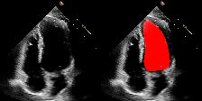
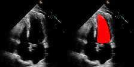
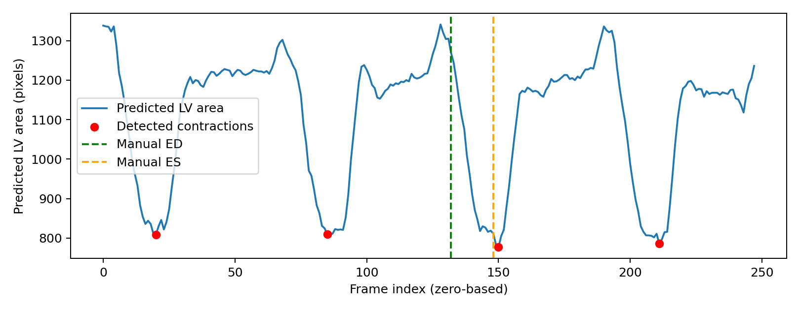
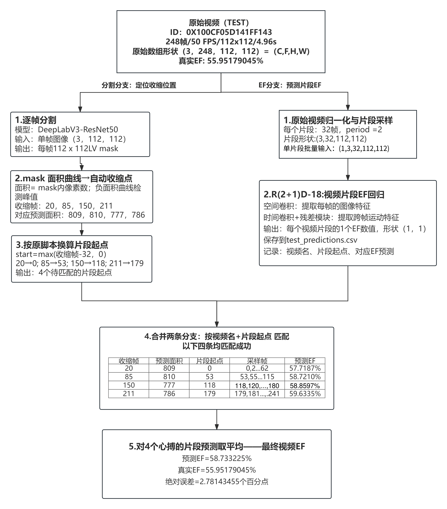

# EchoNet-Dynamic Phase 0 Reproduction and Workflow Report

# 1. Task Summary:

1\. **Understand the original project**: Read the paper and official code to understand the dataset, left ventricular segmentation, video-based EF regression, and how they relate.

2\. **Set up the runtime environment**: Clone the official repository, create isolated environments, verify that packages import successfully, run GPU jobs through Slurm, and document the necessary compatibility changes.

3\. **Obtain and inspect the data**: Request access, download and configure the dataset, verify the video counts, resolution, and annotation files, and use the official training, validation, and test splits.

4\. **Reproduce the baseline results**: Train the segmentation and EF regression models separately, complete beat-by-beat prediction and video-level aggregation, and report ED/ES Dice, MAE, RMSE, and R² alongside the paper's results.

5\. **Explain the full workflow**: Draw a flowchart showing how the models are trained separately and how their outputs connect during inference. Use a real test video to demonstrate segmentation, beat detection, clip sampling, clip EF prediction, final averaging, and error calculation.

# 2. Completion Status

I completed full training and independent testing of both models, combined their outputs beat by beat, and traced one real TEST video through the full pipeline. Test ED/ES Dice scores were 0.9327/0.9078. For the final beat-by-beat EF results, MAE and RMSE were 4.1052 and 5.4342 percentage points, respectively, and R² was 0.8029.

# 2.1 Environment Setup and Compatibility Notes

| **Check**                     | **Status** | **Notes**                                                                                          |
|-------------------------------|------------|----------------------------------------------------------------------------------------------------|
| Official repository           | Pass       | Used echonet/dynamic in ~/projects/dynamic.                                                        |
| Isolated project environments | Pass       | Python environment at ~/envs/echonet and R environment at ~/envs/echonet-r.                        |
| Package imports and CLI       | Pass       | The echonet import and CLI worked. The model passed forward and backward operations.               |
| Slurm GPU jobs                | Pass       | The gpu partition ran training and evaluation for both models. The main jobs were 407–410 and 414. |

**a. Code Baseline Commit**

e01d02947b20604b0ba1a427f3cf6f4890dc4e9c

| **Component**                           | **Actual Environment**                                                                                                              |
|-----------------------------------------|-------------------------------------------------------------------------------------------------------------------------------------|
| Server                                  | Ubuntu 24.04.4 LTS, aarch64, NVIDIA GB10.                                                                                           |
| Python and deep learning                | Python 3.11.18, PyTorch 2.9.1+cu130, torchvision 0.24.1, and PyTorch CUDA build 13.0.                                               |
| Main numerical and imaging dependencies | NumPy 1.23.5, pandas 1.5.3, SciPy 1.11.4, scikit-learn 1.3.2, scikit-image 0.21.0, Matplotlib 3.7.5, and OpenCV headless 4.10.0.84. |
| R                                       | R 4.4.3. ggplot2, stringr, plyr, dplyr, lubridate, reshape2, scales, ggthemes, and Metrics loaded successfully.                     |

## b. Necessary Changes

1\. In setup.py, I changed the package names from sklearn to scikit-learn and from opencv-python to opencv-python-headless to support installation on a headless server.

2\. When saving checkpoints in video.py, I explicitly converted the NumPy scalar returned by r2_score to a Python float to avoid a safe deserialization error in the newer PyTorch version. The loss, model, and predictions stayed the same.

3\. I adapted the official beat_by_beat_analysis.R script for file paths, the FileName/Filename column names, and the .avi suffix. I read metadata IDs as character strings to prevent numeric parsing from breaking matches for hexadecimal-style IDs starting with 0X.

# 2.2 Data Access and Official Splits

I requested and obtained dataset access with my personal account, then downloaded and extracted the data and configured the paths. The dataset root was ~/datasets/EchoNet-Dynamic. DATA_DIR in echonet.cfg pointed to that directory.

| **Split** | **Official File Count** | **Files Available After Loading** |
|-----------|-------------------------|-----------------------------------|
| TRAIN     | 7,465                   | 7,460                             |
| VAL       | 1,288                   | 1,288                             |
| TEST      | 1,277                   | 1,276                             |
| Total     | 10,030                  | 10,024                            |

The official Echo data loader keeps samples with at least two distinct traced frames, which accounts for the difference in counts. I kept that filter and the original split assignments in FileList.csv.

| **Check**             | **Result**                                                                                                                           |
|-----------------------|--------------------------------------------------------------------------------------------------------------------------------------|
| Videos and resolution | Videos/ contained 10,030 AVI files at a spatial resolution of 112 × 112. FPS was read from the video metadata.                       |
| Main metadata         | FileList.csv contains FileName, EF, ESV, EDV, FPS, NumberOfFrames, Split, and other fields.                                          |
| Manual contours       | VolumeTracings.csv contains traced frames and LV contours used to create segmentation supervision.                                   |
| Prediction coverage   | VAL had 1,288 videos / 149,132 clips. TEST had 1,276 videos / 147,271 clips. The TEST prediction and segmentation filenames matched. |

# 3. Full Training of Both Models

| **Parameter**                | **Segmentation Model**                  | **EF Model**                                  |
|------------------------------|-----------------------------------------|-----------------------------------------------|
| Job / model                  | 407 / DeepLabV3-ResNet50                | 408 / R(2+1)D-18                              |
| Supervision and optimization | ED/ES images and masks. Pixel-wise BCE. | Original video clips and video-level EF. MSE. |
| Optimizer                    | SGD, momentum=0.9                       | SGD, momentum=0.9                             |
| epoch / batch / workers      | 50 / 20 / 4                             | 45 / 20 / 4                                   |
| lr / weight decay            | 1e-5 / 0                                | 1e-4 / 1e-4. StepLR step size 15.             |
| Sampling / seed              | Annotated ED/ES frames / 0              | 32 frames, period=2 / 0                       |
| Best validation result       | Loss 0.03510784 at epoch 15             | MSE 28.19188053 at epoch 29                   |

#  4. Test Results and Baseline Comparison

Jobs 409 and 410 completed segmentation and EF evaluation. Job 414 completed beat-by-beat analysis after the ID parsing fix. R² uses the official R script's linear fit. Segmentation covered 1,276 test videos. Two had no matching beat clip, leaving 1,274 for beat-by-beat EF evaluation.

| **Task**                   | **Baseline** | **This Run** | **Evaluation Videos (N)** |
|----------------------------|--------------|--------------|---------------------------|
| LV segmentation ED Dice    | 0.927        | 0.9327       | 1,276                     |
| LV segmentation ES Dice    | 0.903        | 0.9078       | 1,276                     |
| Final beat-by-beat EF MAE  | ≈ 4.1        | 4.1052       | 1,274                     |
| Final beat-by-beat EF RMSE | ≈ 5.3        | 5.4342       | 1,274                     |
| Final beat-by-beat EF R²   | ≈ 0.81       | 0.8029       | 1,274                     |

# 5. A Real TEST Video and Its Segmentation Output

| **Item**               | **Actual Value**                                                |
|------------------------|-----------------------------------------------------------------|
| Video ID               | 0X100CF05D141FF143 (TEST)                                       |
| Video information      | 248 frames, 50 FPS, 112 × 112, duration 4.96 s.                 |
| Original array         | (3,248,112,112) in (C,F,H,W) order.                             |
| Reference labels       | EF 55.95179045%, EDV 107.7315779 mL, and ESV 47.45383119 mL.    |
| Manually traced frames | ED frame 132, area 1,315 pixels. ES frame 148, area 781 pixels. |

I selected this case in TEST order. Each exported pair shows the original frame on the left and the predicted LV mask in red on the right. Red marks model output only.

<table>
<colgroup>
<col style="width: 50%" />
<col style="width: 50%" />
</colgroup>
<tbody>
<tr>
<td>

ED traced frame 132
</td>
<td>

ES traced frame 148
</td>
</tr>

</tbody>
</table>

Blue shows predicted area by frame. Red dots mark detected contractions. Green is manual ED, orange is manual ES.

# 5.1 Test Video Inference Flowchart

# 5.2 Clip Sampling and Final EF

The original script computes the clip start for matching as start = max(contraction frame − 32, 0). Each clip samples 32 frames at stride 2 using indices start + 2k (k = 0, …, 31).

| **Beat frame** | **Pred. area** | **Start** | **Sampled Frames (Stride 2)** | **Clip EF** |
|----------------|----------------|-----------|-------------------------------|-------------|
| 20             | 809            | 0         | 0,2,…,62                      | 57.7187%    |
| 85             | 810            | 53        | 53,55,…,115                   | 58.7210%    |
| 150            | 777            | 118       | 118,120,…,180                 | 58.8597%    |
| 211            | 786            | 179       | 179,181,…,241                 | 59.6335%    |

## How a Clip Passes Through R(2+1)D

The clip is first normalized using training-set statistics and has shape (3,32,112,112). Adding the batch dimension gives (1,3,32,112,112) in (B,C,T,H,W) order, representing one clip with 3 image channels, 32 frames, and images of size 112 × 112. R(2+1)D factorizes spatial and temporal convolutions and uses residual blocks to extract appearance and motion features. After global average pooling, a single-output fully connected regression head predicts EF with output shape (1,1).

For example, at contraction frame 150, frames 118,120,…,180 from the original video form the clip. The saved prediction for that clip is 58.8597%. The segmentation branch determines which clip to use. The clip still contains the original ultrasound pixels.

**Calculating the Final EF**

Take the equally weighted mean of the EF predictions for the four beat clips:

$$EFmean\  = \ \frac{57.7187\  + \ 58.7210\  + \ 58.8597\  + \ 59.6335}{4}\  = \ 58.733225\%$$

$$Absolute\ error\  = \ |58.733225\  - \ 55.95179045|\  = \ 2.78143455\ pp$$
